I build tools for the Linux desktop and experiments that make database behavior visible. Here are three projects you can run and explore.

## Selected projects

**[LIFUX ↗](https://github.com/will035/LIFUX)** · `C` `GTK4` `CMake`  
Flash a Linux ISO to a USB drive from a graphical interface. A separate writer handles privileged disk access and sends progress back to the desktop app.

**[Transact Lab ↗](https://github.com/will035/transact-lab-v1)** · `Node.js` `PostgreSQL`  
What happens when two buyers want the last ticket? Run both purchases with and without a row lock, then inspect the SQL to see why the outcomes differ.

**[Currency Calculator ↗](https://github.com/will035/calculadora_de_divisas_python)** · `Python` `PySide6`  
Convert between ten currencies in a Qt desktop app that caches currency icons locally.

## Toolbox

## Contribution activity

<picture>
  <source media="(prefers-color-scheme: dark)" srcset="https://raw.githubusercontent.com/will035/will035/main/assets/contributions-dark.svg" />
  
</picture>
